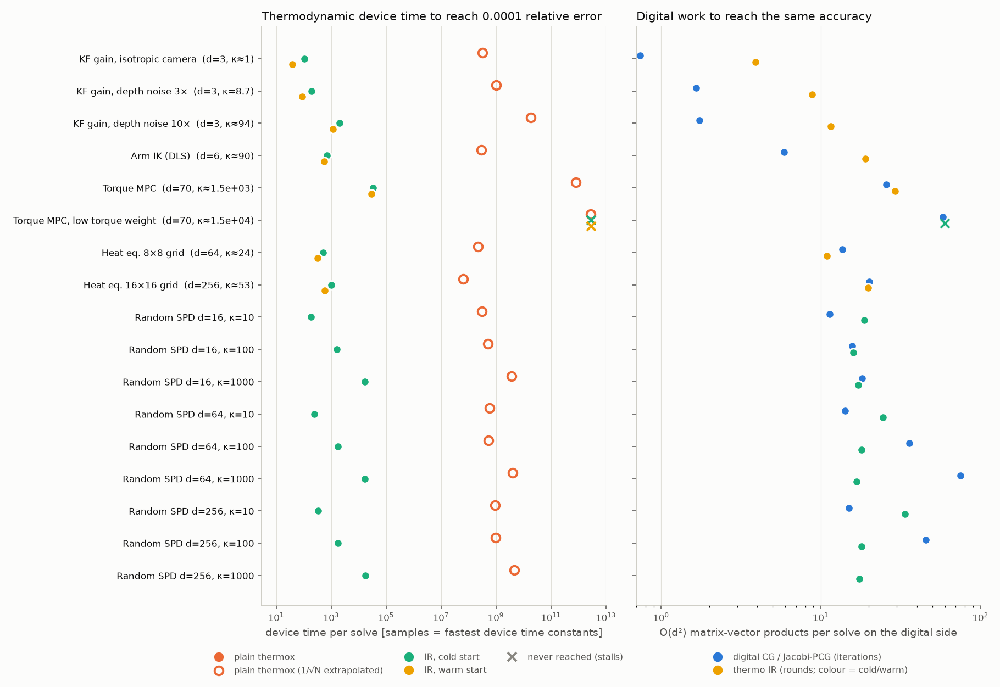
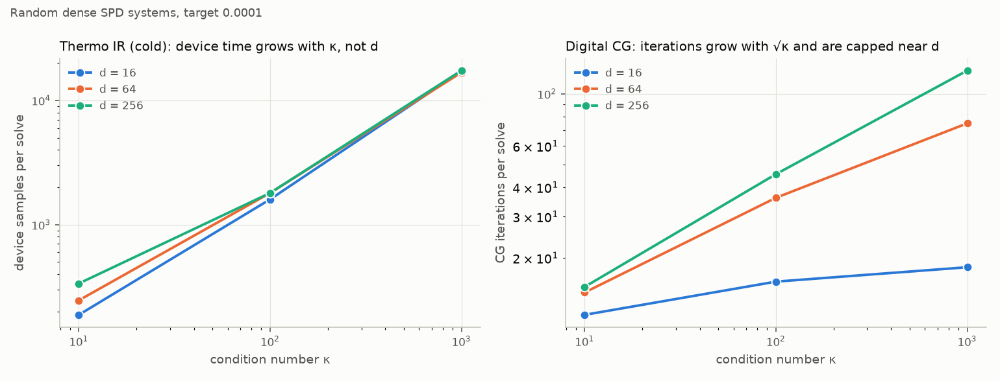
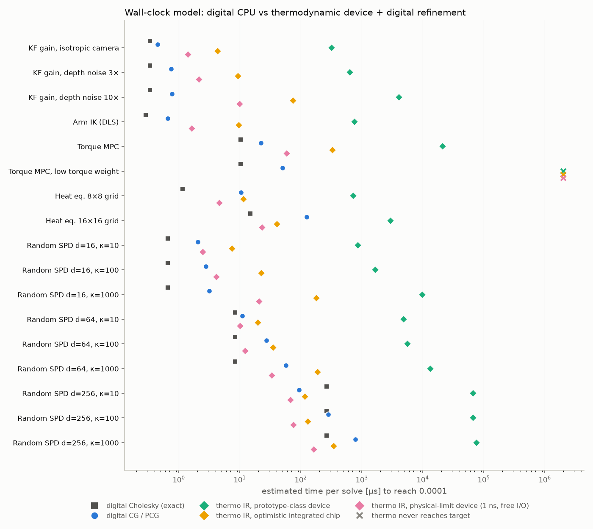
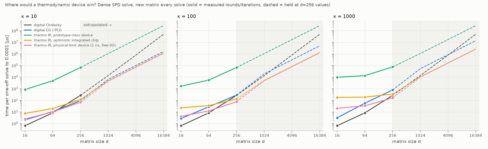
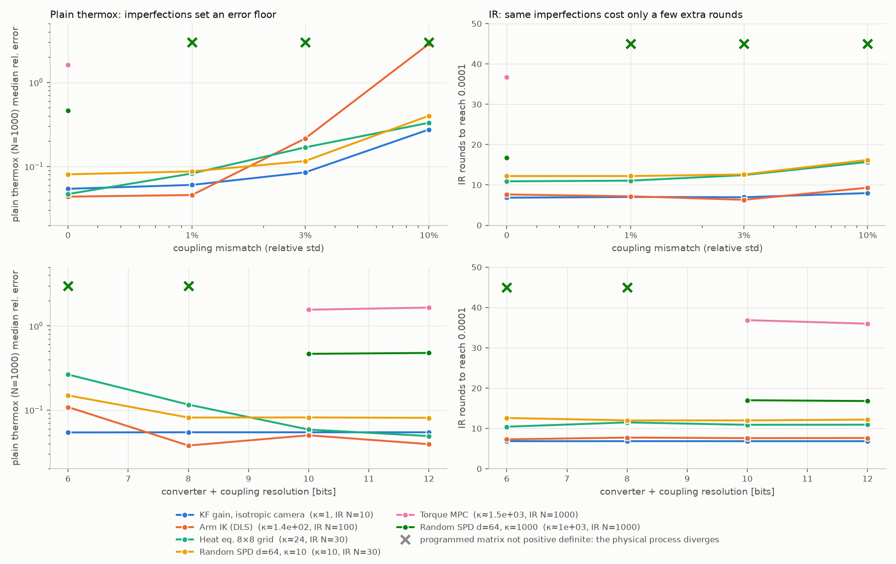

# Thermodynamic linear solves vs. digital solvers: problem-set benchmark

Does warm-started iterative refinement (IR) around a thermodynamic solver hold up
beyond the pick-and-place Kalman gain? And how practical is it physically? This study
tests it on 17 problem sets against normal digital solvers, adds realistic hardware
imperfections, and estimates wall-clock time with published hardware numbers.

## Summary

1. **IR beats plain thermodynamic solving everywhere it converges.** To reach 1e-4
   relative error, plain thermox would need 10⁸–10¹² device samples (extrapolated
   with 1/√N). IR needs about 40–33,000, which is 10⁵–10⁷× less device time. Warm start
   cuts that by a further 1.1–2.8× on every problem that is a sequence of solves.
2. **The device cost follows the condition number κ, not the size d.** IR needs
   about 200 / 1,700 / 17,000 samples at κ = 10 / 100 / 1000, whether d = 16, 64 or 256.
   At κ ≈ 15,000 (torque MPC with a low torque weight) it never converges.
3. **On robot-sized problems (d ≤ 70), the CPU wins by a wide margin.** A CPU Cholesky
   solve takes 0.3–10 µs. Even an optimistic future integrated chip with IR takes
   4–330 µs, and today's prototype-class hardware takes 0.3–21 ms. The bottleneck is
   matrix programming, I/O round trips and device settling, not maths.
4. **A thermodynamic advantage only appears for large dense systems.** At d ≥ 1024,
   an optimistic chip with IR is modelled to beat the faster of Cholesky and CG on one
   CPU core by about 1.3–5×, with the larger gains at higher κ. That comes from needing
   fewer digital matrix-vector products than CG, not from device speed. Normal Computing's own analysis reaches the same conclusion: competitive only
   at d ≈ 1000+.
5. **Imperfect hardware is where IR matters most, and also where it hits a hard limit.**
   - Coupling mismatch (up to 10%) and low-precision converters (6–8 bit) push plain
     thermox to 30–290% error. IR still reaches 1e-4 at the cost of a few extra rounds.
   - On ill-conditioned problems (κ ≳ 1000), even **1% mismatch makes the programmed
     matrix non-positive-definite, so the physical process diverges**. No algorithm
     can fix that.

## What was tested

| Problem set | Source | d | RHS | κ (median) | Systems | Matrix changes |
|---|---|---|---|---|---|---|
| KF gain, isotropic camera | your pick-and-place KF | 3 | 6 | 1 | 116 | every update |
| KF gain, depth noise 3× / 10× | same, oblique depth-camera noise | 3 | 6 | 8.7 / 94 | 116 | every update |
| Arm IK (damped least squares) | Panda IK during approach, first iteration per tick | 6 | 1 | 90 | 199 | every tick |
| Torque MPC | condensed 10-step joint-torque MPC with Panda mass matrix M(q) | 70 | 1 | 1.5e3 | 95 | every tick |
| Torque MPC, low torque weight | same, torque weight 1e-3 | 70 | 1 | 1.5e4 | 95 | every tick |
| Heat equation 8×8 / 16×16 | implicit Euler with a moving heat source | 64 / 256 | 1 | 24 / 53 | 30 | never (fixed) |
| Random dense SPD | log-spaced eigenvalues, random eigenvectors | 16, 64, 256 | 1 | 10, 100, 1000 | 5 each | independent |

**Methods.** The target is relative error ≤ 1e-2, 1e-4 and 1e-6 against numpy's exact
solve. A configuration counts only if ≥ 95% of solves reach the target.

| Method | What it is |
|---|---|
| Cholesky | exact digital direct solve (cost model only) |
| CG / Jacobi-PCG | standard digital iterative solver, cold or warm start; the best variant is reported |
| Plain thermox | one device solve of N samples from x₀ = 0, N ∈ {10, 100, 1000, 10000} (as in the robot test) |
| Thermo IR | device solve inside digital iterative refinement, cold or warm start, N ∈ {10…1000}, with or without Jacobi scaling; the best variant is reported |

**Device model.** thermox's own OU sampler (`sample_identity_diffusion`), checked
statistically against `thermox.linalg.solve` (mean error 0.431 vs 0.428 over 3,000 runs).
Choices that keep it physically fair:

- **Matrix scaling.** The matrix is scaled so its *top* eigenvalue is 1, so one time
  unit is the fastest relaxation the hardware allows. The cheaper Gershgorin bound
  overestimates this about 10× for dense matrices and would unfairly slow the device;
  the digital side is instead charged 5 power iterations per new matrix.
- **Input scaling.** Each right-hand side is scaled so its largest entry uses the full
  input range, because every cell has its own DAC. The original robot code's unit
  2-norm scaling is up to √d noisier.
- **Not modelled (optimistic for the device):** output voltage-swing limits, and noise
  sources other than the OU process itself.
- **Stopping rule.** Both CG and IR use the same oracle stopping rule (true error).
  IR also stops once it gains less than 2× over 5 rounds, i.e. it has stalled.

## Results

### Device time and digital work (target 1e-4)



| Problem | d | κ | Plain thermox samples | IR cold | IR warm | Digital CG iters |
|---|---|---|---|---|---|---|
| KF gain, isotropic camera | 3 | 1 | 3.2e8 (extrap.) | 109 (10.9×N=10) | **39** (3.9×N=10) | 0.7 |
| KF gain, depth noise 3× | 3 | 8.7 | 1e9 (extrap.) | 197 (19.7×N=10) | **88** (8.8×N=10) | 1.7 |
| KF gain, depth noise 10× | 3 | 94 | 1.9e10 (extrap.) | 1,997 (20×N=100) | **1,159** (11.6×N=100) | 1.7 |
| Arm IK (DLS) | 6 | 90 | 2.9e8 (extrap.) | 710 (23.7×N=30) | **572** (19.1×N=30) | 5.9 |
| Torque MPC | 70 | 1.5e3 | 8.1e11 (extrap.) | 33,337 (33×N=1000) | **29,221** (29×N=1000) | 25.7 |
| Torque MPC, low torque weight | 70 | 1.5e4 | 2.8e12 (extrap.) | stalls | stalls | 58.3 |
| Heat eq. 8×8 | 64 | 24 | 2.2e8 (extrap.) | 505 (16.8×N=30) | **327** (10.9×N=30) | 13.7 |
| Heat eq. 16×16 | 256 | 53 | 6.3e7 (extrap.) | 1,032 (34×N=30) | **594** (19.8×N=30) | 20.1 |
| Random SPD d=16, κ=10 / 100 / 1000 | 16 | | 3e8 – 3.7e9 | 188 / 1,600 / 17,200 | – | 11 / 16 / 18 |
| Random SPD d=64, κ=10 / 100 / 1000 | 64 | | 5e8 – 4e9 | 246 / 1,800 / 16,800 | – | 14 / 36 / 75 |
| Random SPD d=256, κ=10 / 100 / 1000 | 256 | | 1e9 – 4.8e9 | 336 / 1,800 / 17,400 | – | 15 / 45 / 126 |

The right panel of the figure is a hardware-independent comparison. Each IR round
and each CG iteration costs one O(d²) matrix-vector product on the digital side:

- **Small d:** CG wins. It finishes in at most d iterations (1–6 for KF and IK) while
  IR needs 4–20 rounds.
- **Large d and large κ:** IR wins. At d=256, κ=1000 it needs 17 rounds versus 126 CG
  iterations. The device effectively acts as a very strong preconditioner.



### Wall-clock estimate

Hardware assumptions:

- **Digital:** one x86 AVX2 core. Effective speed rises from ~1 GFLOP/s at d ≤ 6 to
  ~20 GFLOP/s at d=256, matching measured small-matrix Cholesky rates. Matrix-vector
  products are memory-bound beyond the cache.
- **Thermodynamic devices** (relaxation time / overhead per round / matrix programming):

| Scenario | Relaxation time | Per-round overhead | Matrix programming | Basis |
|---|---|---|---|---|
| Prototype-class | 0.5 µs | 50 µs | 1 µs per entry | Normal Computing's 8-cell PCB SPU: RLC cells, ~0.2–0.6 µs time constants, FPGA + 12 MHz 10-bit ADC + host link |
| Optimistic integrated chip | 10 ns | 200 ns | row-parallel DACs, plus d² 16-bit entries over a 50 Gb/s link | not yet built |
| Physical-limit bound | 1 ns | free | free | an upper bound, not a design |



| Problem | Cholesky | CG | Prototype-class | Optimistic chip | Physical limit |
|---|---|---|---|---|---|
| KF gain, isotropic camera | 0.33 µs | 0.44 µs | 321 µs | 4.4 µs | 1.4 µs |
| KF gain, depth noise 10× | 0.33 µs | 0.77 µs | 4.1 ms | 75 µs | 9.9 µs |
| Arm IK (DLS) | 0.29 µs | 0.66 µs | 762 µs | 9.7 µs | 1.6 µs |
| Torque MPC | 10 µs | 22 µs | 21 ms | 329 µs | 59 µs |
| Torque MPC, low torque weight | 10 µs | 50 µs | never | never | never |
| Heat eq. 16×16 (fixed matrix) | 15 µs | 125 µs | 3.0 ms | 41 µs | 23 µs |
| Random SPD d=256, κ=100 | 266 µs | 281 µs | 67 ms | **132 µs** | **75 µs** |
| Random SPD d=256, κ=1000 | 266 µs | 778 µs | 75 ms | 345 µs | **164 µs** |

Even at 1e-2 accuracy, which is about what the robot needs, the optimistic chip takes
1.5–166 µs on the robot problems versus 0.3–10 µs for Cholesky.



Extrapolating the d=256 round and iteration counts to larger one-off dense solves
(dashed region, model only):

| d | κ | Cholesky | CG | Optimistic chip + IR |
|---|---|---|---|---|
| 1024 | 100 | 13.5 ms | 19 ms | 5.2 ms |
| 4096 | 100 | 789 ms | 305 ms | 83 ms |
| 4096 | 1000 | 789 ms | 844 ms | 166 ms |
| 4096 | 10 | 789 ms | 101 ms | 76 ms |

At this scale the time is dominated by the digital residual matrix-vector products,
not by the device. The comparison is against one CPU core; a GPU or a strongly
preconditioned solver (multigrid, incomplete Cholesky) would move the break-even point
further out.

### Physical imperfections



- **Coupling mismatch** (fixed random relative error on every programmed matrix entry):
  - Plain thermox degrades quickly. Arm IK goes from 4% to 287% error at 10% mismatch.
  - IR still reaches 1e-4. Heat 8×8 needs 10.9 → 15.7 rounds; IK reaches the target in
    92% of solves at 10% mismatch.
- **Converter and coupling resolution:**
  - At 6 bits, plain thermox error rises up to about 5×.
  - IR round counts barely change.
- **Stability limit:**
  - For κ ≈ 1000–1500 (random d=64, torque MPC), **1% mismatch makes the programmed
    matrix non-positive-definite in 100% of solves**, so the physical OU process diverges.
  - The MPC also needs at least 10-bit couplings.
  - Rule of thumb: programming precision must be finer than about 1/κ. Today's analog
    parts are far coarser: the SPU prototype offers 4 diagonal capacitor values and 3
    coupling values (−, 0, +), and IBM's 2023 analog chip uses 8-bit inputs and outputs.

## Physical practicality

| Requirement | Status |
|---|---|
| Device solve with error < 100% per round (IR needs ε < 1) | met in emulation for κ ≲ 1000 with N ≈ κ samples |
| Reprogram the matrix every control tick | the main cost for robotics. O(d²) entries per tick; for d ≤ 70 this alone exceeds a CPU solve |
| Digital↔analog round trip per IR round | 4–35 round trips per solve; needs on-chip converters (~100 ns), not an FPGA/USB link |
| Coupling precision finer than 1/κ | not available today for κ ≳ 100; ill-conditioned robotics problems (MPC) need preconditioning first |
| Large all-to-all arrays (d ≥ 1000) | needed for any speed advantage; d² programmable couplings (~1M at d=1024). Analog in-memory chips already reach 64 × 256² at 8-bit I/O, but no thermodynamic solver of that size exists |

**Bottom line:**

- **For robot-sized linear algebra (Kalman gains, IK, small MPC),** a thermodynamic
  co-processor is not practical. A CPU solves these in well under a microsecond to tens
  of microseconds, and the overheads of talking to any analog device are larger than
  the whole digital solve.
- **Where it could pay off:** large dense SPD systems (d ≥ 1000) with moderate
  conditioning, solved on a chip with fast on-chip converters and precise couplings.
- **Warm-started IR is still the right way to drive such a chip.** It turns a 1/√N
  noise floor into geometric convergence and absorbs component mismatch and
  low-precision converters.

## Limitations

- Wall-clock numbers come from a model with stated assumptions, not measured hardware;
  the d > 256 points are extrapolated.
- thermox has no output voltage-swing limit, parasitic dynamics, or drift; real devices
  will be worse.
- Oracle stopping (true error) is used for both CG and IR. A real controller would stop
  on the residual.
- Only Jacobi preconditioning was tried. Good preconditioners would help both CG and the
  device; for the MPC, Jacobi made conditioning worse.
- The digital baseline is a single CPU core.

## Reproduce

```bash
export PANDA_DIR=menag/franka_emika_panda MUJOCO_GL=egl
python thermo_benchmark.py --problem all                  # ~10 min sequential; or one name per process
python thermo_benchmark.py --nonideal kf_iso:10,ik:100,heat8:30,rand_d64_k10:30,rand_d64_k1000:1000,mpc:1000
python thermo_benchmark.py --report                       # tables + figures in results_bench/
```

`thermo_benchmark.py` holds the problem sets, solvers and device emulator;
`thermo_benchmark_report.py` holds the tables, wall-clock model and figures.

## Sources

- Melanson et al., *Thermodynamic computing system for AI applications* (SPU prototype), [arXiv:2312.04836](https://arxiv.org/abs/2312.04836)
- Aifer et al., *Thermodynamic linear algebra*, [arXiv:2308.05660](https://arxiv.org/abs/2308.05660)
- Aifer et al., *Error mitigation for thermodynamic computing*, [arXiv:2401.16231](https://arxiv.org/abs/2401.16231)
- Le Gallo et al., *Mixed-precision in-memory computing*, Nature Electronics 2018, [arXiv:1701.04279](https://arxiv.org/abs/1701.04279)
- Le Gallo et al., *A 64-core mixed-signal in-memory compute chip* (IBM HERMES), [arXiv:2212.02872](https://arxiv.org/abs/2212.02872)
- Frison et al., *BLASFEO* (small dense linear algebra performance), [arXiv:1704.02457](https://arxiv.org/abs/1704.02457)
